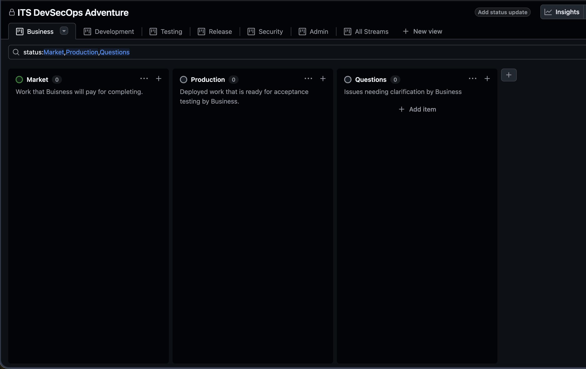

# Starting Place

1. Go to the `Business` tab of the project board.
   

# Sprint Planning

## Request a Drawing of a Dog

1. Choose one drawing from the following list:
   1. [Puppy Sitting](https://www.online-coloring.com/coloring-page/cute-puppy-sitting-on-ground-1658.html)
   2. [Puppy Lying Down](https://www.online-coloring.com/coloring-page/cute-puppy-lying-on-the-floor-1657.html)
   3. [Pomerainian](https://www.online-coloring.com/coloring-page/cute-pomeranian-dog-1586.html)
1. Choose **one acceptance criteria** for the drawing.
   - **Examples**:
     - _Sitting Puppies have a brown ears and eye patches_
     - _Puppies laying down have green paws_
     - _Pomerainians have blue tails_
1. Click `+` on the right side of the `Market` column.
1. Enter the description of the drawing as stated above (e.g. "Puppy Sitting")
1. Click `Create Issue`

### Provide the URL

1. Click `Edit` in the top right corner of the issue window
   - This window appears on the right when you create the issue.
1. Click the dropdown menu under the title `Description`.
1. Select `Drawing Request` as the issue template.
1. Copy the URL for the drawing to description.
1. Click `Save Changes`

### Add Labels

1. Click on `Edit` in the `Labels` section
   - The `Labels` section is the third section after the descrition
   - `Edit` is on the right side of the screen.
1. Add the labels.
   - Search and select `Sprint 1`
   - Seach and select `Batch Size 4`
   - Seach and select `Price 100`
1. Offer the work to one of the teams.
   - Search and select `Team::#` where `#` is team that does not already have work.
   - If all teams have work, do not add a team label.

# Sprint Execution

1. Request at least two more drawings.
1. Request more drawings if you have time.

## Request a Drawing of a Cat

1. Select one drawing from the following list:
   1. [Cute Kitten](https://www.online-coloring.com/coloring-page/lovely-cat-1673.html)
   1. [Fuzzy Kitten](https://www.online-coloring.com/coloring-page/kitten-1053.html)
   1. [Cartoon Kitten](https://www.online-coloring.com/coloring-page/cartoon-kitten-822.html)
1. Choose **one acceptance criteria** for the drawing.
   - **Examples**:
     - _Cute Kittens have pink fur_
     - _Fuzzy Kittens have green tail_
     - _Cartoon Kittens have blue stripes_
1. Follow the same procedure for requesting a drawing of a dog.

### Labels

1.  Add the label **Batch Size: 3**
1.  Add the label **Price: 75**

## Request a Drawing of a Bird

1. Select one drawing from the following list:
   1. [Owl](https://www.online-coloring.com/coloring-page/halloween-owl-1425.html)
   2. [Pigeon](https://www.online-coloring.com/coloring-page/cartoon-pigeon-989.html)
   3. [Cartoon Bird](https://www.online-coloring.com/coloring-page/cartoon-bird-811.html)
1. Choose **one acceptance criteria** for the drawing.
   - **Examples**:
     - _Owls have purple wings_
     - _Pigeons have green and blue neck rings_
     - _Cartoon Birds have red eyes_
1. Follow the same procedure for requesting a drawing of a dog.

### Labels

1.  Add the label **Batch Size: 2**
1.  Add the label **Price: 50**

## Provide Feedback to Developers

1. Monitor the `Feedback` column for issues with developer questions.
1. Add a comment to the issue with your response.
1. Set the **Status** to `In Progress`.

## Approve Completed Products

1. Monitor the issues with the `In Production` status.
1. Examine the drawings created by the development team.

**Immediately reject any drawing for a development team that has not asked what your expectations are!**

### Acceptance Criteria Met

1. Add the `Accepted` label to the product request.

### Acceptance Criteria NOT Met

1. Add a comment about what is wrong with the drawing.
1. Add the label `Needs Work`.
1. Set the issue's **Status** to `In Development`.

# Sprint Review

Discuss with your team (Business) the following three questions:

1. What are the top two things that went well?
1. What are the top two things that did not go so well?
1. What are two changes your team would like to make in the next sprint?
