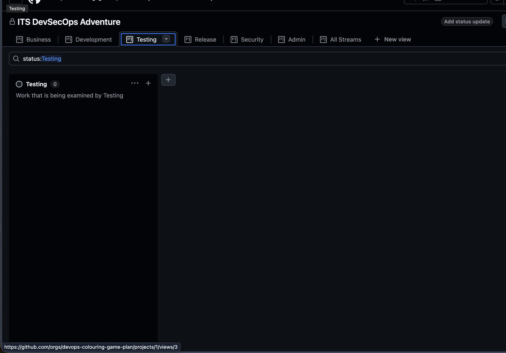

# Starting Place

1. Go to the `Testing` tab of the project board.
   

# Sprint Planning

1. Read the [`Definition of Done`](../../Definition%20of%20Done.md) document to know:
   - The requirements of a completed drawing.
   - The requirements for a deployment package.

# Sprint Execution

1. Moniter the `Testing` column for completed product requests.
1. Click on the name of the product request to open.
1. Examine the items in `Child Items` section.
1. Confirm that:
   - Products meet the criteria for **Definition of Done - Single Product**
   - If a product passes testing:
     1. Set the **Status** of the product to `Testing Passed`
   - If a product fails testing:
     1. Add a comment indicating the problem with the product.
     1. Set the **Status** of the product to `Testing Failed`
     1. Add the label `Needs Work` to the product request.
     1. Set the **Status** of the product request to `In Progress`.
1. Confirm that:
   - Product request meets the criteria for **Definition of Done - Deployment Package**
   - If the product request passes:
     1. Set the **Status** to `Security`
   - If the product request fails:
     1. Add a comment indicating the problem with the product request.
     1. Add the label `Needs Work` to the product request.
     1. Set the **Status** of the product request to `In Progress`.

# Sprint Review

Discuss with your team (**Development** & **Testing**) the following three questions:

1. What are the top two things that went well?
1. What are the top two things that did not go so well?
1. What are two changes your team would like to make in the next sprint?
