# Setup Requirements

1. An active GitHub account.
2. The GitHub account names for all of the students.

# Setting Up the Activity

## Create a GitHub organization and team for the activity

1. Create a Free organization at https://github.com/organizations/plan
   - A suggested name would be a combination of the course (e.g. CPSC 3720) and the semester (Fall 2025)
2. Create a team for the organization called "ITS DevSecOps"
   - 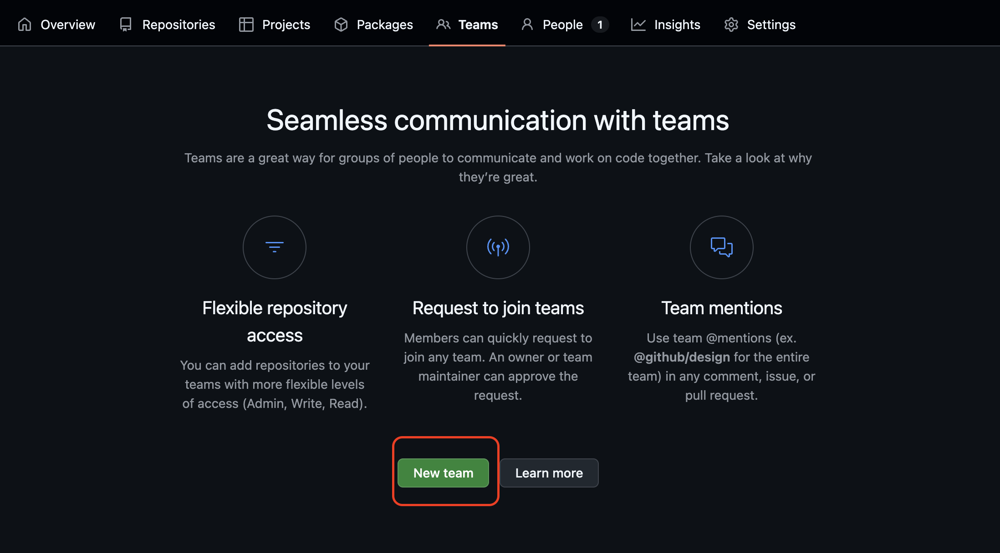
   - Leave the visibility as `Visible`
   - Change notifications to `Disabled`
   - 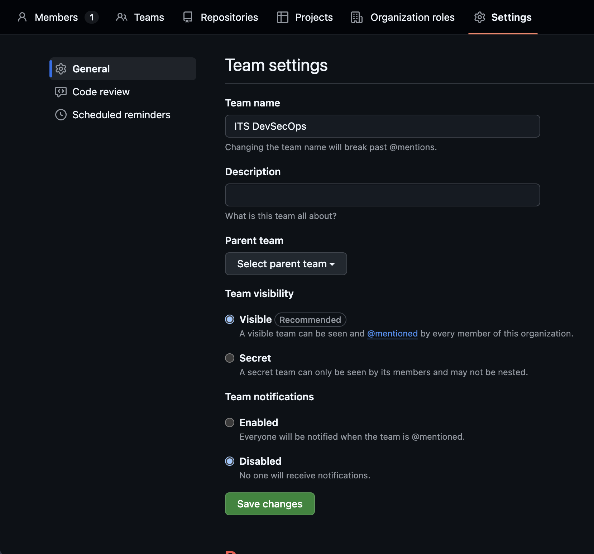
3. Set the default permissions for team members to be `Write` so students can create issues.
   - Go to `Settings` for the Organization
   - Select `Member Privileges`
   - Set `Base permissions` to `Write`
   - 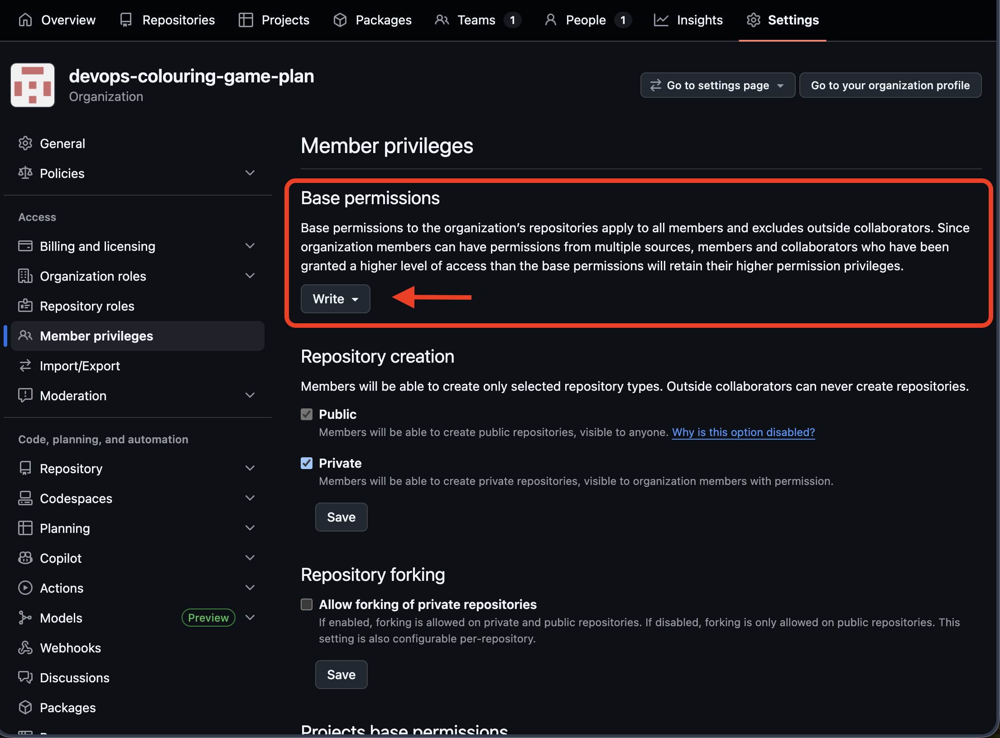

## Create the ITS DevSecOps Adventure repository

1. Return to https://github.com/johnanvik/devops-colouring
2. Click the button "Use this template" in the upper right corner to create a new copy of the repository. 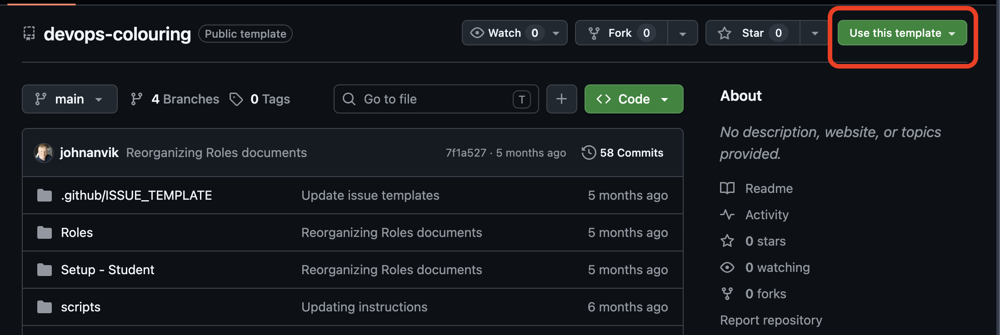
   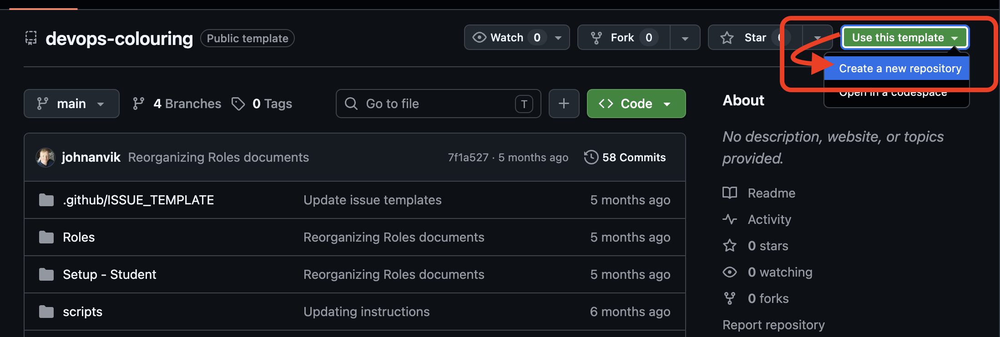
3. Change the owner of the repository to the newly created organization.
4. Call the new repository "ITS DevSecOps Adventure" (_**Make sure you set the new org you have just created above as the owner for the repo.**_)

   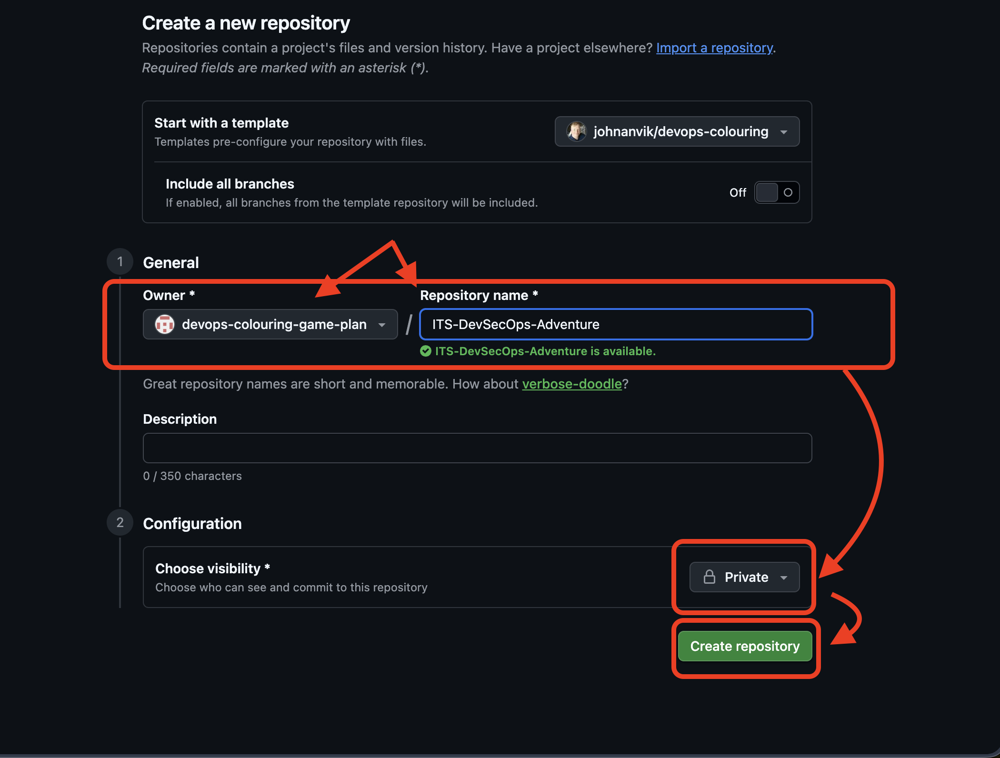

5. Leave the visibility as "Private"
6. Create the repository by clicking "Create repository"
7. In `Settings`, under `Features`, turn on `Issues` (if not already done so).

   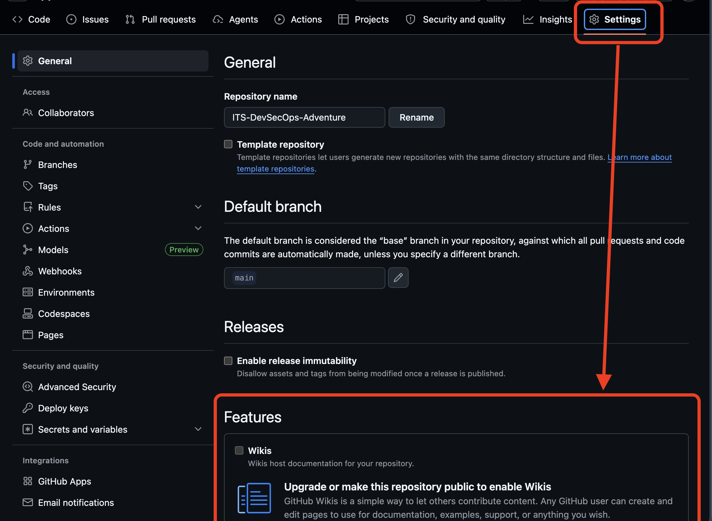
   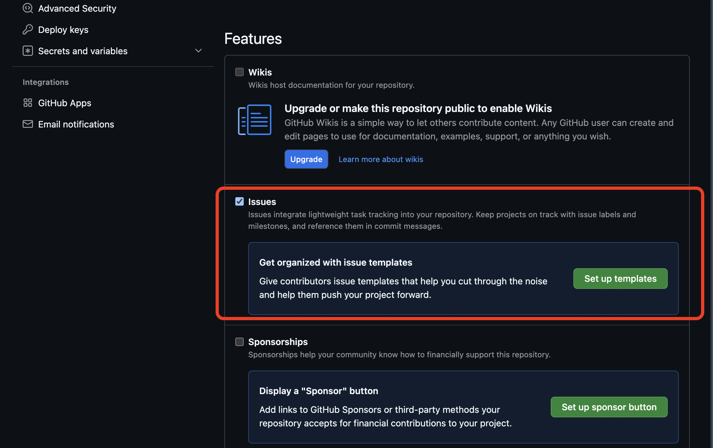

## Configure the repository (requires GitHub CLI to be installed)

1. Open a terminal
1. Login using the GitHub CLI
   - `gh auth login` and follow the prompts
1. Run the script `copylabels.sh` in the `scripts` folder with your org and repo names:
   - `scripts/copylabels.sh <organization name> <repository name>`
     - Example: scripts/copylabels.sh CPSC3720Fall2025 ITS-DevSecOps-Adventure
       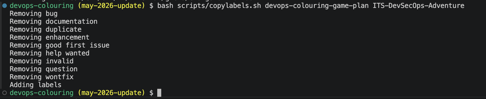
1. Confirm that labels were created.
   - (_You can check at `https://github.com/<your-org-name>/<your-repo-name>/labels`_)
   - Expected labels include "Batch Size", "Price", "Team 1", etc.
     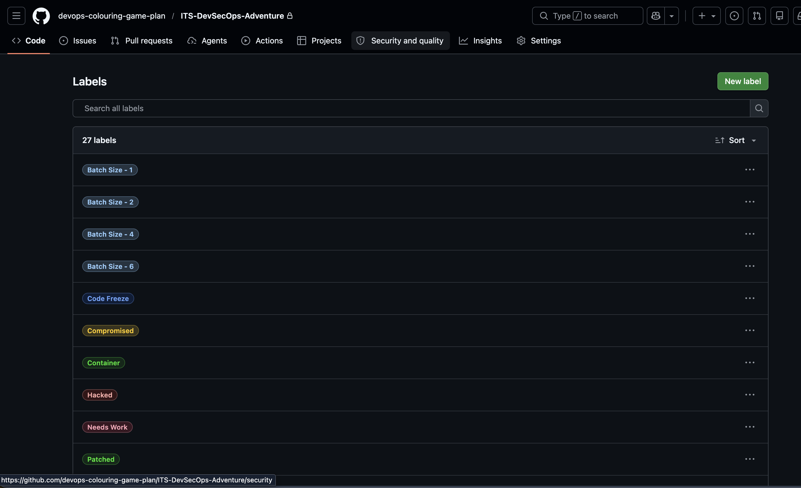

## Create the ITS DevSecOps Adventure project

1. Go to https://github.com/orgs/DevSecOpsAdventure/projects/15
2. Click "Use this template" in the upper righthand corner.
   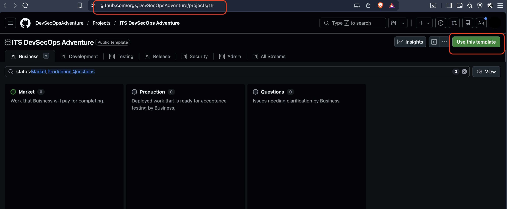
3. Select the orgranization you created as the `Owner`.
4. Enter `ITS DevSecOps Adventure` as the name of the project.
5. Click **Use Template**
   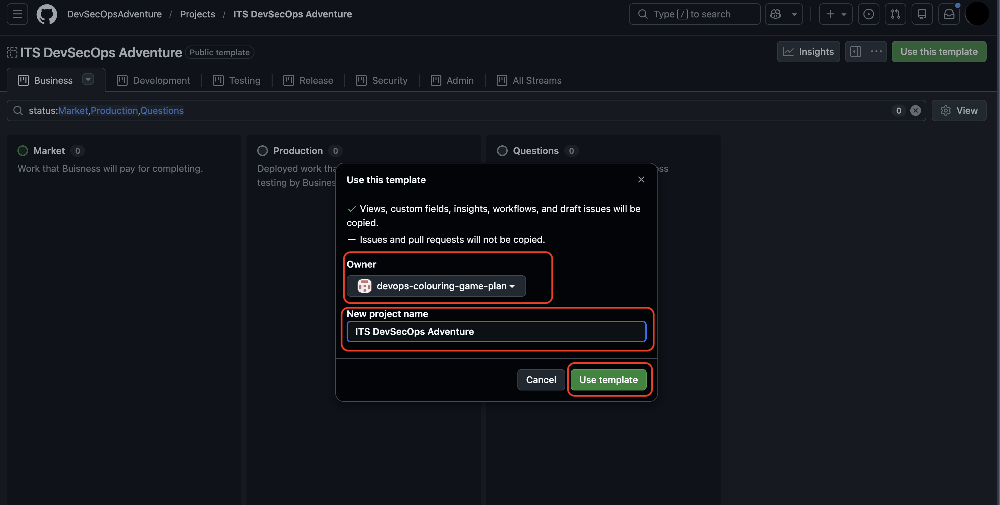
6. (Needs to be set to private?)

## Link the project to the repository

1. Click `Projects` at the top of the repository page.
2. Click **Link New Project**
3. Select `ITS DevSecOps Adventure`
4. Click **Submit**
   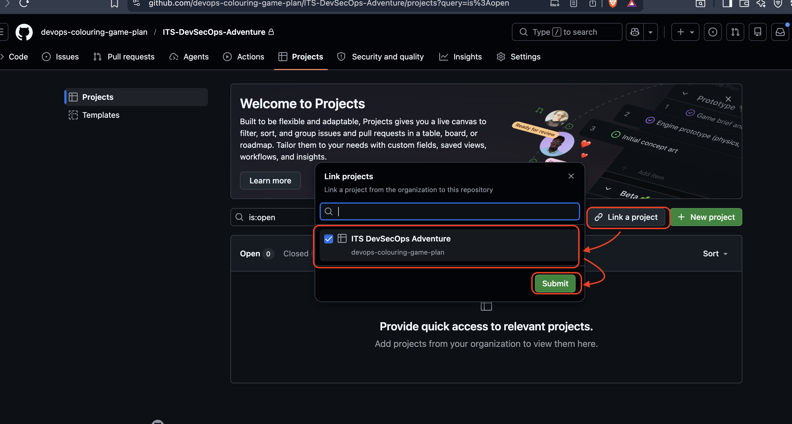

### Giving students permission to the project board

1. Go to `Settings` of the project board (three dots on right, under the profile picture)
   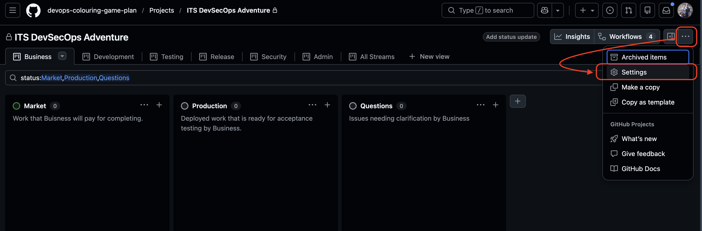
2. Set the `Default Repository` to the newly created one.
3. Save changes.
   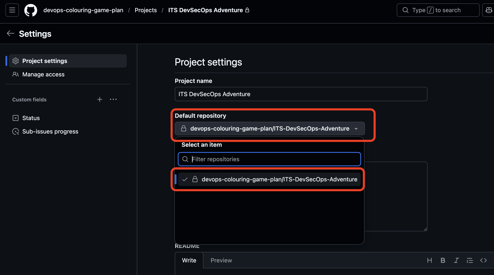
   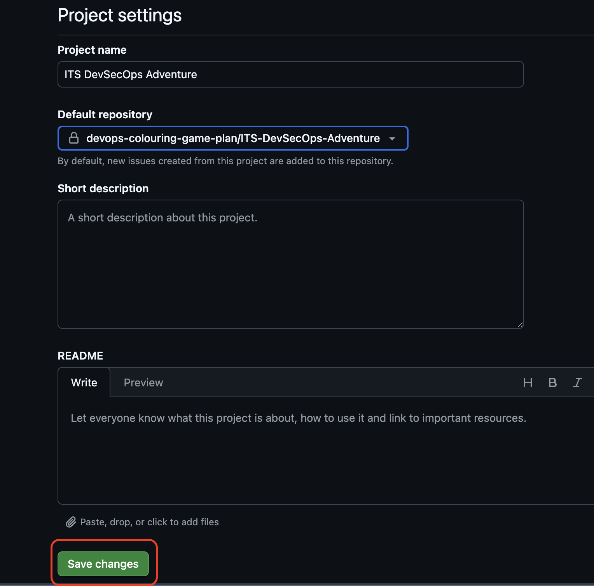
4. Select `Manage Access` from the left-side panel.
5. Enter "ITS DevSecOps" (the team you created) in the `Invite Collaborators' search.
6. Add the team with `Write` permissions
   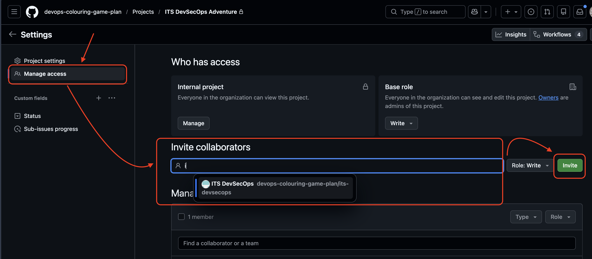

# Adding Collaborators

## Adding students to the project's team

### For now, this needs to be done manually by sending an invite to each student

1. Make a local clone of https://github.com/johnanvik/devops-colouring
1. Create a CSV file called `students.csv` in the scripts folder
1. Add the GitHub user names of all the students to the CSV file, one user name per line.
1. On a Unix command-line run the following commands:
   - `gh auth login`
     - Log into GitHub from the commandline
     - You may need to create a fine-grained personal access token for the organization (https://docs.github.com/en/organizations/managing-programmatic-access-to-your-organization/setting-a-personal-access-token-policy-for-your-organization)
       - Go to `Organizations` under your account
       - Set the owner to the created organization
       - Set Repository Access to "All repositories"
       - Set the permissions to "Adminstrator"
   - `./add-users-to-team-from-list.sh students.csv <org> its-devsecops`
     - \<org> is organization you created for this activity.
     - DOESN"T WORK! GET THE FOLLOWING: 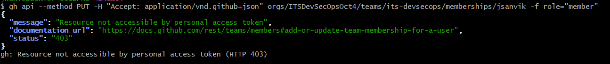
1. Students will need to accept the invite to the team before they can be added to the project.

## Adding students to the project

### For now, this needs to be done manually AFTER sending an invite to each student and they accept

1. Run `./add-all-students-to-project.sh <org> "ITS DevSecOps Adventure" <project-number>`

- \<org> is organization you created for this activity.
- \<project-number> is the number appearing at the end of the URL for your project (e.g. "1")

# Training

TODO: Create a tutorial video showing how to use GitHub project (or find one?)
